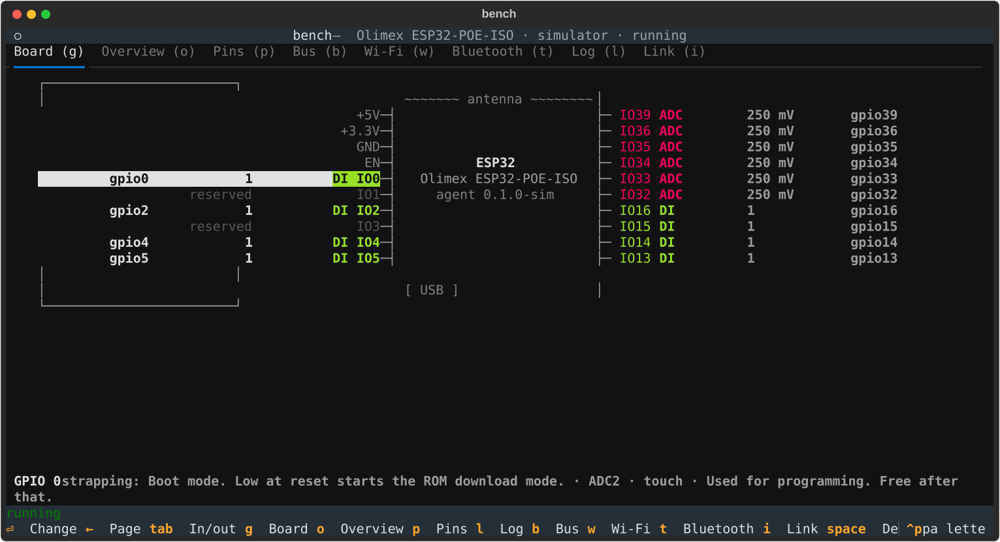
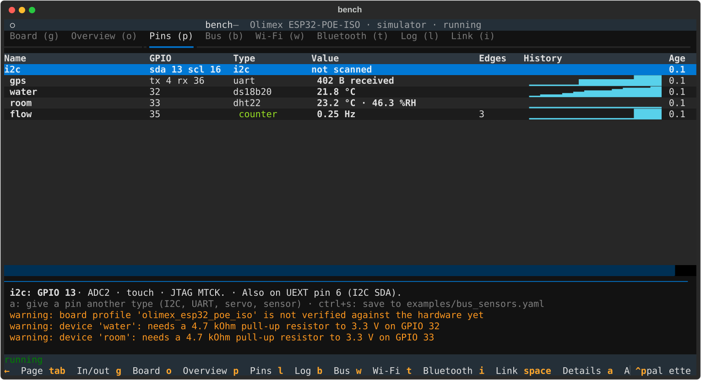
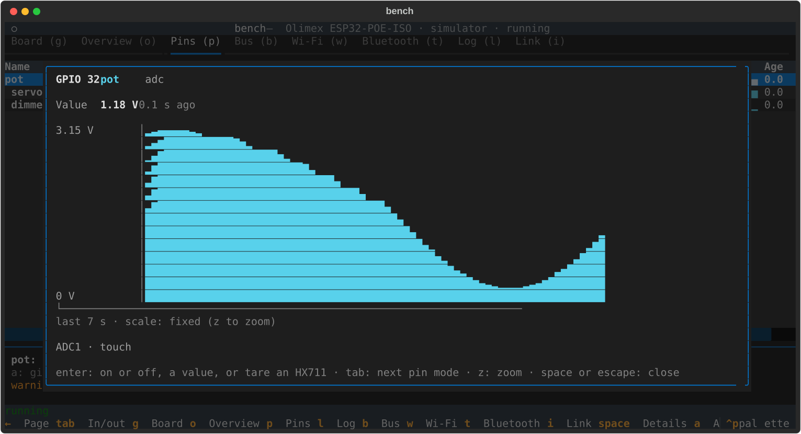
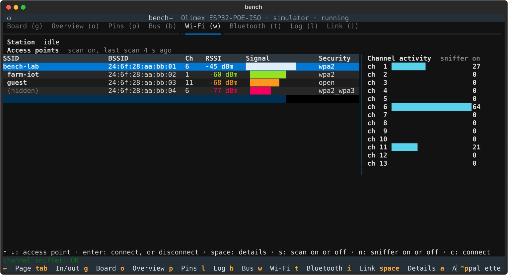
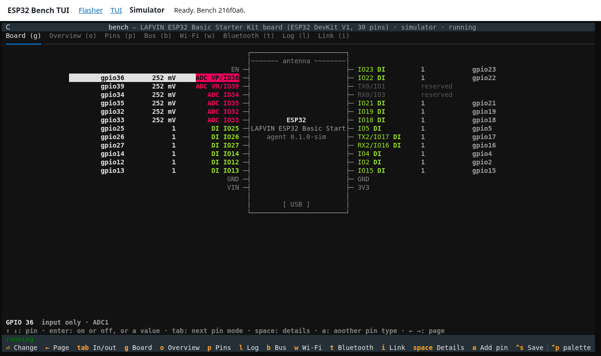

# ESP32 Bench TUI

ESP32 Bench TUI is a tool for bench tests on ESP32 boards. Flash one generic firmware, the bench agent, to the board one time. Then connect a sensor or an actuator to a pin. The TUI shows its live value at once, and lets you control the outputs. You do not need to build new firmware when you change a sensor. The TUI runs in a terminal or in the browser.

## Try It

- **In the browser, with no board:** open the [simulator](https://batchcodes.github.io/esp32_bench_tui/simulator/). It works in every browser.
- **In the browser, with a board:** flash the bench agent with the [web flasher](https://batchcodes.github.io/esp32_bench_tui/), then open the [web TUI](https://batchcodes.github.io/esp32_bench_tui/tui/). Use Chrome, Edge or Opera.
- **In a terminal:** run `./bench --sim` to try it with no board. With Docker, you install nothing else. Refer to [Getting started](docs/getting_started.md).

## Screenshots

| Pins page                                                                                                        | Pin detail view                                                                                           |
| ---------------------------------------------------------------------------------------------------------------- | --------------------------------------------------------------------------------------------------------- |
|  |  |

| Wi-Fi page                                                                                               | Web TUI in Chrome                                                                                             |
| -------------------------------------------------------------------------------------------------------- | ------------------------------------------------------------------------------------------------------------- |
|  |  |

## How It Works

- **Bench agent firmware** in [firmware/bench_agent](firmware/bench_agent). The agent does not know which sensors are connected. The TUI sends the pin configuration when it connects.
- **Board profiles** in [boards](boards). Each profile lists the pins of one board and what each pin can do. The TUI refuses a configuration that puts a pin into a mode that it cannot use.
- **Host TUI** in [host/bench](host/bench). A Python program with a [Textual](https://textual.textualize.io/) user interface. In the browser, the same Python code runs with [Pyodide](https://pyodide.org/).

| Mode                | Board firmware | What you get                                                               |
| ------------------- | -------------- | -------------------------------------------------------------------------- |
| `agent`             | bench agent    | live values of all configured pins, and control of the output pins         |
| `log`               | any firmware   | values taken from the normal serial log output with regex rules, read-only |
| simulated (`--sim`) | no board       | a simulated agent, for a test of the TUI or of a configuration             |

## Supported Boards

| Profile                         | Board                                     | Chip                 |
| ------------------------------- | ----------------------------------------- | -------------------- |
| `olimex_esp32_poe_iso`          | Olimex `ESP32-POE-ISO`                    | ESP32                |
| `lafvin_esp32_devkit`           | LAFVIN ESP32 Basic Starter Kit            | ESP32 (ESP-WROOM-32) |
| `heltec_wireless_paper_v1_2`    | Heltec Wireless Paper V1.2                | ESP32-S3             |
| `elecrow_crowpanel_epaper_1_54` | Elecrow CrowPanel ESP32 E-Paper HMI 1.54" | ESP32-S3             |
| `esp32_devkitc`                 | Espressif `ESP32-DevKitC`                 | ESP32                |
| `esp32_s3_devkitc_1`            | Espressif `ESP32-S3-DevKitC-1`            | ESP32-S3             |
| `esp32_c3_devkitm_1`            | Espressif `ESP32-C3-DevKitM-1`            | ESP32-C3             |
| `esp32_c6_devkitc_1`            | Espressif `ESP32-C6-DevKitC-1`            | ESP32-C6             |

Every other board with one of these chips works with a generic profile, for example `generic_esp32`.

## Documentation

| Document                                             | Contents                                                                  |
| ---------------------------------------------------- | ------------------------------------------------------------------------- |
| [Getting started](docs/getting_started.md)           | Flash the board and start the TUI in the browser, with Docker or locally. |
| [Using the TUI](docs/using_the_tui.md)               | The pages and keys, open mode, listen mode and HX711 load cells.          |
| [Project configuration](docs/project_config.md)      | The YAML file of the devices on the board.                                |
| [Web flasher](docs/web_flasher.md)                   | Flash the bench agent from the browser.                                   |
| [Web TUI](docs/web_tui.md)                           | The TUI and the simulator in the browser, and how they work.              |
| [Board profiles](docs/board_profiles.md)             | The board and chip files.                                                 |
| [Adding a board](docs/adding_a_board.md)             | Write a profile for a new board.                                          |
| [Adding a device type](docs/adding_a_device_type.md) | Add a sensor or an actuator type to the firmware and the TUI.             |
| [Wire protocol](docs/protocol.md)                    | The JSON messages between the TUI and the bench agent.                    |

## Contributing

Refer to [CONTRIBUTING.md](CONTRIBUTING.md). To make the TUI screenshots again after a change to the pages, run `.venv/bin/python scripts/screenshots.py`.

## Licence

The code is under the [MIT licence](LICENSE). The Olimex pinout image in [docs/images/boards](docs/images/boards) has its own licence. Refer to [docs/images/boards/NOTICE.md](docs/images/boards/NOTICE.md).
